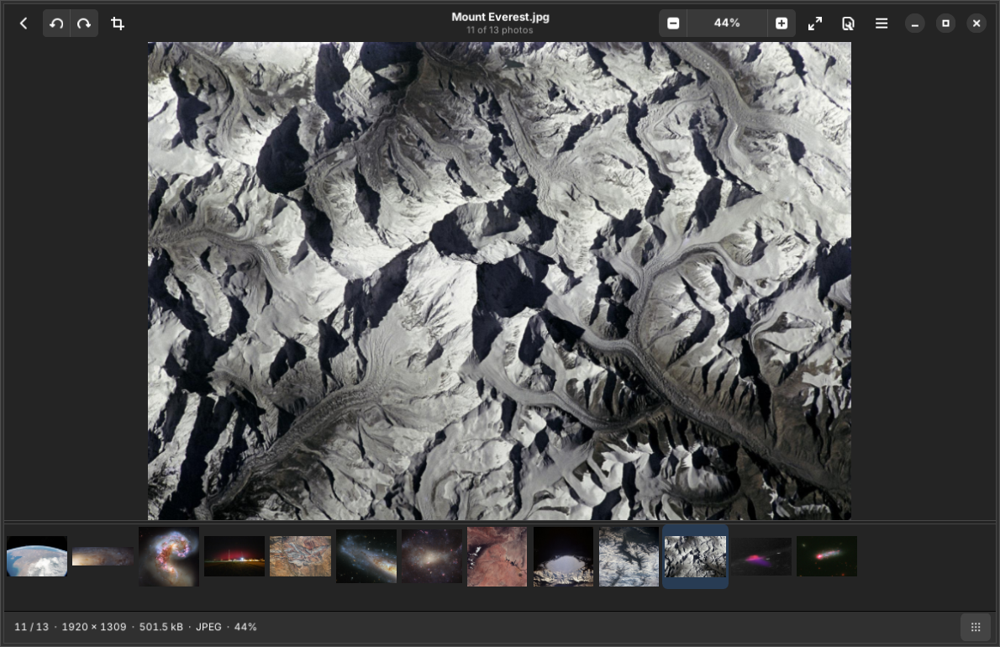
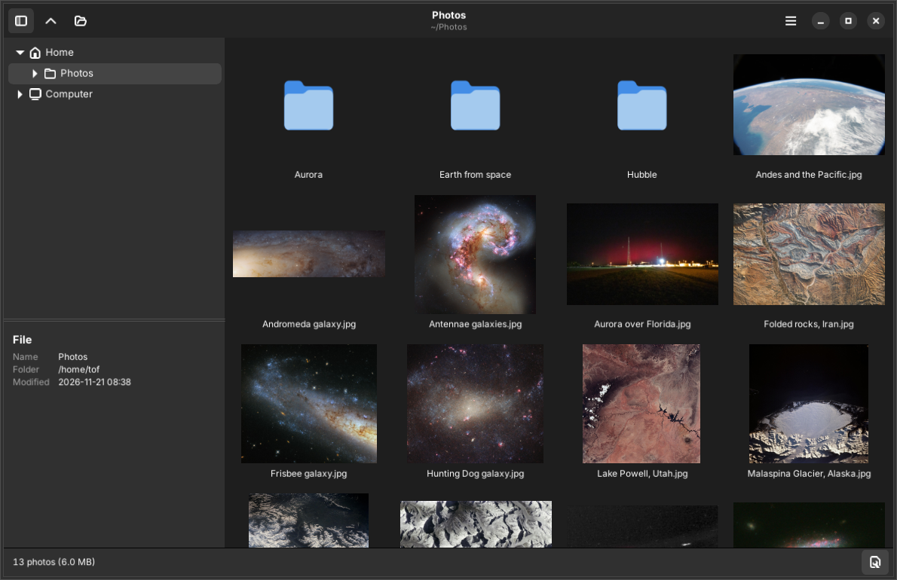
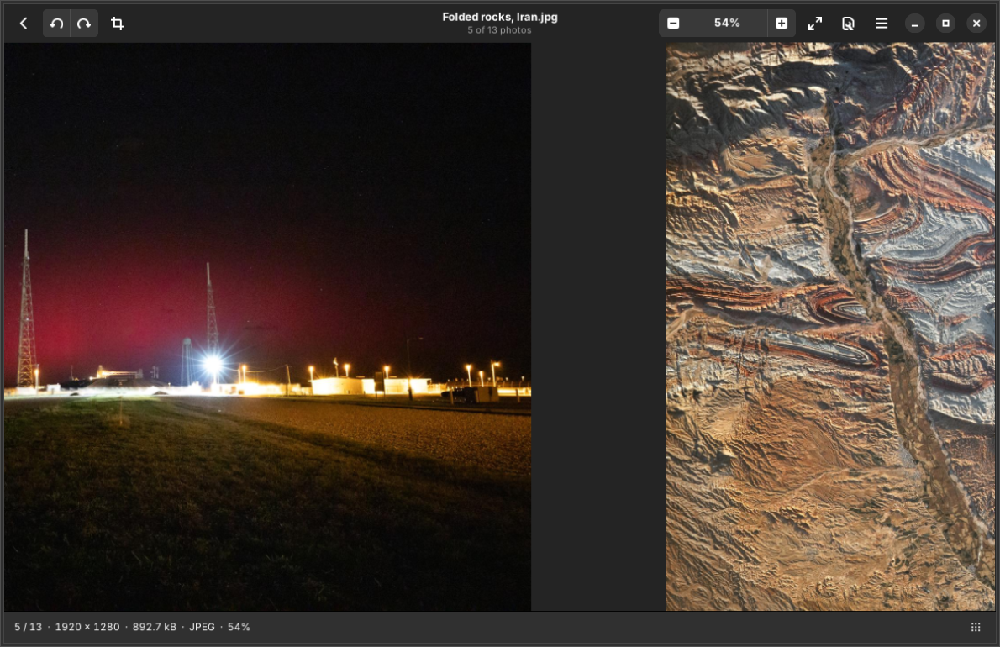
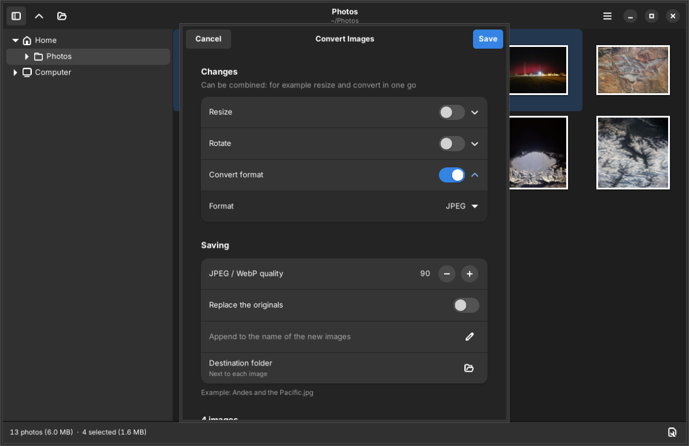

# Argos

**A simple and fast photo viewer for GNOME — GTK4 / libadwaita.**
**Une visionneuse de photos simple et rapide pour GNOME — GTK4 / libadwaita.**

[English](#english) · [Français](#français) · Site : https://tofmicro.pages-perso.free.fr/Argos/



| Grid / Grille | Slideshow / Diaporama | Convert / Convertir |
|---|---|---|
|  |  |  |

---

## English

Argos shows the photos of a folder as a grid of thumbnails, with a folder tree on the side, and opens them in a
viewer laid out like gThumb. Navigation comes from FastStone: the mouse wheel goes to the next or previous photo,
Ctrl + wheel zooms around the pointer. It follows your desktop theme (Adwaita, light or dark, accent colour,
installed GTK4 theme).

### Features
- **Grid** of the folder's photos in natural order, with thumbnails shared with Nautilus, a **folder tree**
  (home, Pictures, mounted disks, computer) and a **properties** panel (I). Four thumbnail sizes (Preferences, or
  Ctrl + wheel), several photos selected with the mouse, Ctrl or Shift, a folder you come back to shows at once.
- **Viewer**: wheel = next / previous photo, Ctrl + wheel = zoom around the pointer, drag to move a zoomed
  photo, double click = plain full screen, neighbouring photos read in advance, animated GIFs.
- **Thumbnail strip** under the photo with an adjustable height, **status bar** (« 4 / 858 · 1920 × 1080 ·
  1.9 MB · JPEG · 56% »), **properties** with the shooting details (camera, lens, exposure, ISO…).
- **Slideshow** (F5): full screen, a photo every few seconds, Space to pause, Escape to stop. Photos **slide in**
  (or fade in, or no transition — Preferences), also when browsing with the keyboard or the wheel. In full screen,
  the arrows and the pointer hide when the mouse rests.
- **Simple editing**: rotate (R / Shift+R), crop (C, with aspect ratios), save (the original can be restored
  right after) or save as another format (JPEG, PNG, WebP, TIFF, BMP, GIF).
- **Convert / resize** several photos at once (Ctrl+E): resize, rotate and convert in one go.
- **Annotate** (A): rectangle, ellipse, arrow, line, freehand, highlighter, pixelate and text, with undo; the photo
  is replaced safely (Undo right after, date and camera details kept) or saved as a new image.
- **Right-click**: set as wallpaper, print, open with, copy image, copy or move to, rename (F2), trash, delete.
- Opens on the last folder, on Pictures or on a folder of your choice (Preferences).
- Formats: JPEG, PNG, GIF, WebP, TIFF, BMP, SVG, HEIC, AVIF (those of GdkPixbuf).
- Default photo viewer switch, English, French and German.

### Install
Ubuntu 24.04 / 26.04, Zorin OS 18, Linux Mint 22:
```sh
sudo add-apt-repository ppa:nourpon/argos
sudo apt update && sudo apt install argos-viewer
```
Other Debian-based distributions: the `.deb` of the [releases](https://github.com/ToFpon/Argos/releases), then
`sudo apt install ./argos-viewer_X_all.deb`. From the source code: `python3 bin/argos [FOLDER|PHOTO]`.

The package is called `argos-viewer` (Debian already has an `argos` package, a Mopidy client); the application is
Argos.

---

## Français

Argos montre les photos d'un dossier en grille de vignettes, avec l'arbre des dossiers à côté, et les ouvre dans
une visionneuse disposée comme gThumb. La navigation vient de FastStone : la molette passe à la photo suivante ou
précédente, Ctrl + molette zoome autour du pointeur. Argos suit le thème du bureau (Adwaita, clair ou sombre,
couleur d'accent, thème GTK4 installé).

### Fonctionnalités
- **Grille** des photos du dossier dans l'ordre naturel, avec les miniatures partagées avec Nautilus, **arbre
  des dossiers** (dossier personnel, Images, disques montés, ordinateur) et panneau des **propriétés** (I). Quatre
  tailles de vignettes (Préférences, ou Ctrl + molette), plusieurs photos sélectionnées à la souris, avec Ctrl ou
  Maj, un dossier où l'on revient s'affiche tout de suite.
- **Visionneuse** : molette = photo suivante / précédente, Ctrl + molette = zoom autour du pointeur, glisser pour
  déplacer une photo agrandie, double-clic = plein écran simple, photos voisines lues d'avance, GIF animés.
- **Bande de vignettes** sous la photo, réglable en hauteur, **barre d'état** (« 4 / 858 · 1920 × 1080 ·
  1,9 Mo · JPEG · 56 % »), **propriétés** avec la prise de vue (appareil, objectif, exposition, ISO…).
- **Diaporama** (F5) : plein écran, une photo toutes les quelques secondes, Espace pour la pause, Échap pour
  arrêter. Les photos **arrivent en glissant** (ou en fondu, ou sans transition — Préférences), aussi en naviguant
  au clavier ou à la molette. En plein écran, les flèches et le pointeur se cachent quand la souris ne bouge plus.
- **Retouche simple** : pivoter (R / Maj+R), recadrer (C, avec proportions), enregistrer (l'original peut être
  rétabli juste après) ou enregistrer sous un autre format (JPEG, PNG, WebP, TIFF, BMP, GIF).
- **Convertir / redimensionner** plusieurs photos d'un coup (Ctrl+E) : redimensionner, pivoter et convertir en une
  passe.
- **Annoter** (A) : rectangle, ellipse, flèche, trait, main levée, surligneur, pixellisation et texte, avec
  Ctrl+Z ; la photo est remplacée en toute sécurité (« Annuler » juste après, date et appareil gardés) ou
  enregistrée comme nouvelle image.
- **Clic droit** : définir comme arrière-plan, imprimer, ouvrir avec, copier l'image, copier ou déplacer vers,
  renommer (F2), corbeille, supprimer.
- S'ouvre sur le dernier dossier, sur Images ou sur un dossier choisi (Préférences).
- Formats : JPEG, PNG, GIF, WebP, TIFF, BMP, SVG, HEIC, AVIF (ceux de GdkPixbuf).
- Interrupteur « Visionneuse de photos par défaut », anglais, français et allemand.

### Installation
Ubuntu 24.04 / 26.04, Zorin OS 18, Linux Mint 22 :
```sh
sudo add-apt-repository ppa:nourpon/argos
sudo apt update && sudo apt install argos-viewer
```
Autres distributions dérivées de Debian : le `.deb` des [publications](https://github.com/ToFpon/Argos/releases),
puis `sudo apt install ./argos-viewer_X_all.deb`. Depuis le code source : `python3 bin/argos [DOSSIER|PHOTO]`.

Le paquet s'appelle `argos-viewer` (Debian a déjà un paquet `argos`, un client de Mopidy) ; l'application, Argos.

## Licence

GPL-3.0-or-later. Photos des captures / screenshot photos : NASA (domaine public / public domain).
